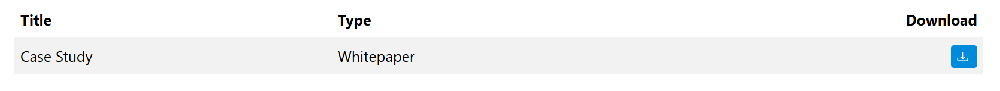
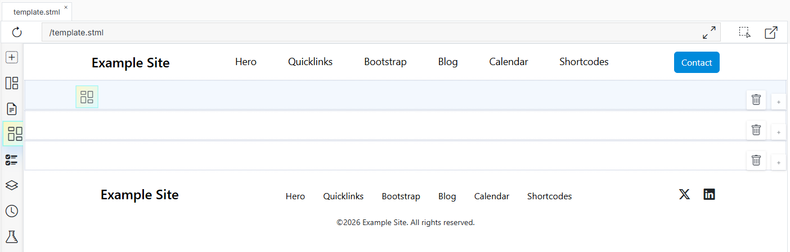

#

<link rel="stylesheet" href="/static/custom.css">

<div class="header">
  <div class="inner">
    
    <div>
      <h1>Documents</h1>
      <p>Upload documents and publish downloadable files.</p>
    </div>
  </div>
  <a href="https://solodev-marketplace.s3.us-east-1.amazonaws.com/modules/documents/latest.zip" class="btn-blue-lg"><span><svg xmlns="http://www.w3.org/2000/svg" viewBox="0 0 16 16" width="20" height="20" fill="#fff"><path d="M2.75 14A1.75 1.75 0 0 1 1 12.25v-2.5a.75.75 0 0 1 1.5 0v2.5c0 .138.112.25.25.25h10.5a.25.25 0 0 0 .25-.25v-2.5a.75.75 0 0 1 1.5 0v2.5A1.75 1.75 0 0 1 13.25 14Z"></path><path d="M7.25 7.689V2a.75.75 0 0 1 1.5 0v5.689l1.97-1.969a.749.749 0 1 1 1.06 1.06l-3.25 3.25a.749.749 0 0 1-1.06 0L4.22 6.78a.749.749 0 1 1 1.06-1.06l1.97 1.969Z"></path></svg></span>DOWNLOAD</a>
</div>

The Solodev Documents Module makes it easy to share files with your audience by organizing them in one central, accessible place. Give users quick access to the forms, guides, and resources they need.

- **Upload and manage documents with ease** – Add files or images, assign a title and document type, and keep everything up to date through a simple module.

- **Organized, accessible display** – Documents appear in a clean, responsive table sorted by title, with each file's type clearly labeled for fast scanning.

- **Instant downloads for visitors** – Every document includes a one-click download button, so users get exactly what they need without searching through pages.

## Prerequisites

- Have a [Solodev CMS](/quickstart).
- Have a [Website](/websites/add-website/).

!!!Note:
We use Bootstrap 5 in our packages. You can update your code to match your own framework, styles, or preferences as needed.
!!!

## Step-by-Step Setup Guide

These steps will guide you through the process of installing the Documents Module and adding it to your page.





1. Navigate to Modules
<ul style="padding-left: 50px;">
  <li>In your CMS dashboard, click <strong>Modules</strong> in the left navigation menu</li>
  <li>Click the <strong>Add Module</strong> button</li>
</ul>

2. [Add the module](/modules/add-module/)
<ul style="padding-left: 50px;">
  <li>Give your documents module a name</li>
  <li>Select the Documents Module from the Module Picker</li>
  <li>Click <span class="text-blue">Submit</span>.</li>
</ul>

<p></p>

!!!Note:
The documents module comes with pre-configured entries that you can customize by accessing the module entry.
!!!





!!!Note:
Newer CMS versions already include a repeater file in the Documents module. If yours does, skip to **Step 3**.
!!!

1. Navigate to `Websites > example.com > web files > content`
<ul style="padding-left: 50px;">
  <li><a href="/websites/folder-overview/add-folder/">Create a folder</a> called <code>documents</code></li>
  <li>In the documents folder, <a href="/websites/folder-overview/add-file/">create a new code file</a> called <code>documents-repeater.tpl</code></li>
</ul>

2. Add the quick links code using the example template provided below.

```html documents-repeater.tpl
<div class="table-responsive">
  <table class="table table-striped align-middle">
    <thead>
      <tr>
        <th scope="col">Title</th>
        <th scope="col">Type</th>
        <th scope="col" class="text-end">Download</th>
      </tr>
    </thead>
    <tbody>
      [repeater id="" display_type="news" order="event_title asc"]
        <tr>
          <td>{{event_title}}</td>
          <td>{{doc_type}}</td>
          <td class="text-end">
            <a href="[get_asset_file_url id='{{doc_file}}']" class="btn btn-sm btn-primary" target="_blank" rel="noopener noreferrer" aria-label="Download {{event_title}}">
              <i class="bi bi-download me-1" aria-hidden="true"></i>Download
            </a>
          </td>
        </tr>
      [/repeater]
    </tbody>
  </table>
</div>

```

<!-- {{{event_title}}} -->

!!!danger Important!
You need to add the ID number of your documents module to the repeater shortcode within the `id=""` attribute.
!!!

3. Click <span class="text-blue">Publish</span>.

4. Open your homepage `index.stml` or the desired page where you want to add the documents.

5. [Insert your documents file](/websites/page-overview/#add-a-file-to-page) into the page.

6. Click <span class="text-blue">Publish</span>.

7. Go to your website and refresh the page to see your documents in action.







1. Open the desired page where you want to add the documents module.

2. Find the vertical icon rail on the left edge of the page canvas. Module is the fourth icon from the top. Drag it onto an empty region of the canvas.



3. Search and select the documents module. Click **Choose**.

4. Click <span class="text-blue">Publish</span>.

5. Go to your website and refresh the page to see your documents in action.




## Support

Support for Documents Module is handled directly through Solodev's global help desk. For more information regarding support queries, go to [www.solodev.com](https://www.solodev.com/).

!!!Note:
To learn more about shortcodes and how they work, visit our [shortcodes](/shortcodes) documentation.
!!!